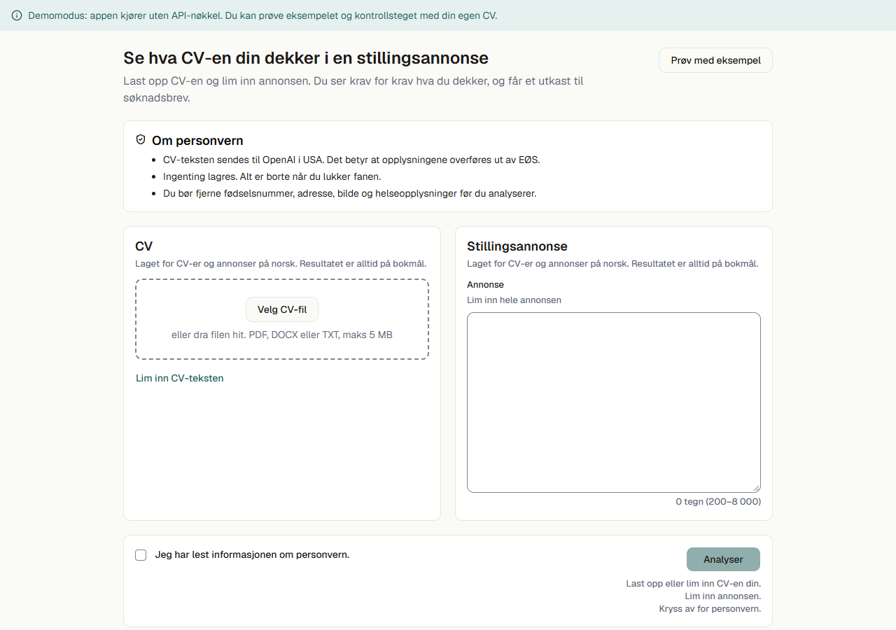
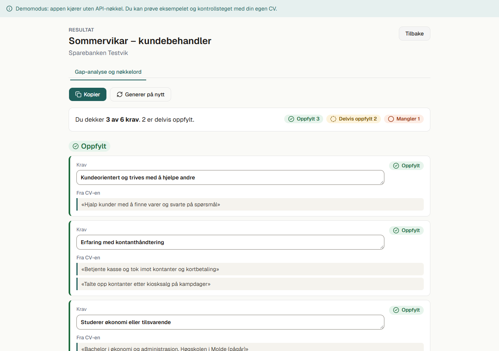

# CV-assistent: se hva CV-en din dekker i en stillingsannonse

Gruppe G69 (Kevin Heggdal og Sondre Skogheim) i **IBE160 Programmering med KI** ved Høgskolen i Molde, høsten 2026.

Appen er for studenter og nyutdannede som søker jobb. Brukeren laster opp CV-en og limer inn en stillingsannonse. Appen viser krav for krav om CV-en dekker kravet (**Oppfylt**, **Delvis oppfylt** eller **Mangler**), siterer ordrett fra CV-en som belegg og gir ærlige råd der noe mangler. Belegget kontrolleres i kode, så appen dikter ikke opp erfaring brukeren ikke har. Søknadsbrev og CV-forbedringer kommer i epic 3 og 4.

| Forside | Resultat (*Prøv med eksempel*) |
|---|---|
|  |  |

## Prøv appen

**Publisert:** https://g69-cv-assistent.vercel.app

- Trykk **Prøv med eksempel** øverst til høyre for å se en ferdig gap-analyse med en fiktiv CV og annonse. Det koster ingenting og sender ingenting til språkmodellen.
- Med egen CV: last opp en PDF, DOCX eller TXT, eller lim inn teksten, kontroller teksten, lim inn annonsen, kryss av for personvern og trykk **Analyser**. Fødselsnumre fjernes automatisk.
- Analysen kan redigeres, kopieres som ren tekst og genereres på nytt.

Den publiserte appen bruker OpenAI `gpt-4.1-mini`. CV-teksten sendes til OpenAI og lagres ikke av appen. Bruk gjerne testdataene i [`testdata/`](testdata/) i stedet for en ekte CV.

## Kjøre appen lokalt

**Krav:** Node.js 24 (`"engines": { "node": "24.x" }`) og npm.

```bash
git clone https://github.com/IBE160-2026/G69-heggdal-skogheim.git
cd G69-heggdal-skogheim
npm ci
npm run dev
```

Åpne http://localhost:3000. Uten API-nøkkel kjører appen i **demomodus**: et banner sier fra, og **Prøv med eksempel** virker fullt ut. Du trenger ingen `.env`-fil for å prøve appen.

Får du feilen «running scripts is disabled on this system» i PowerShell på Windows, bruk `npm.cmd` i stedet for `npm` (`npm.cmd ci` og `npm.cmd run dev`).

### Miljøvariabler (valgfrie)

For ekte analyse kopierer du [`.env.example`](.env.example) til `.env.local` og fyller inn en nøkkel. `.env.local` er ignorert av git.

| Variabel | Betydning | Standard |
|---|---|---|
| `LLM_LEVERANDOR` | `openai` eller `mistral` | `mistral` |
| `OPENAI_API_KEY` / `MISTRAL_API_KEY` | Nøkkelen til den valgte leverandøren. Uten nøkkel: demomodus | tom |
| `LLM_MODELL` | Modellnavnet | `gpt-4.1-mini` (OpenAI), `mistral-medium-latest` (Mistral) |
| `GRENSE_PER_MINUTT` / `GRENSE_PER_DOGN` | Grenser for antall analyser | 10 per minutt, 200 per døgn |

Nøkkelen leses bare på serveren og sendes aldri til nettleseren.

## Tester og kvalitetssjekker

```bash
npm test            # Vitest: enhets- og komponenttester (ca. 900)
npm run lint        # ESLint, også regler for lag og forbudte klasser
npm run typecheck   # TypeScript
npm run build       # produksjonsbygg
```

De samme fire kjøres i GitHub Actions på hver PR ([`.github/workflows/ci.yml`](.github/workflows/ci.yml)). Testnavnene starter med kravet de tester (for eksempel `FR-9:` eller `UX-DR10:`), så hver test kan spores tilbake til PRD-en eller UX-spesifikasjonen. Testene trenger verken nøkkel eller nettverk.

Kvaliteten på svarene fra språkmodellen måles med testsettet under, mot fasitene i [`testdata/`](testdata/) og sjekklisten i [`testdata/sjekkliste.md`](testdata/sjekkliste.md).

### Testsettet (leverandørvalg)

`npm run testsett` kjører gap-analysen for alle fire testparene i `testdata/` tre ganger gjennom den samme pipelinen som appen, og skriver en rapport til [`testsett-rapporter/`](testsett-rapporter/) med kategorier, belegg, nøkkelord, treffprosent, tokens, varighet og kostnad. Skriptet kjøres ikke i CI.

```bash
# Tørrkjøring uten nøkkel og uten nettverk (demosvaret for alle parene)
npm run testsett -- --leverandor mistral --mock

# Ekte måling. Nøkkelen (MISTRAL_API_KEY eller OPENAI_API_KEY) leses fra .env.local.
npm run testsett -- --leverandor openai --pris-inn <kr> --pris-ut <kr>
```

- `--leverandor mistral|openai` er påkrevd.
- `--pris-inn` og `--pris-ut` er kroner per million input- og output-tokens. De er påkrevd ved ekte kjøring og står ikke i koden.
- `--modell <navn>`, `--ganger <antall>` (standard 3) og `--par <mappe>` (for eksempel `par-2-it-support`) er valgfrie.

Rapporter fra ekte målinger committes. Tørrkjøringer får `-mock` i filnavnet og ignoreres av git. Fremgangsmåten og leverandørvalget står i kjørebøkene for story 2.4 ([del B](_bmad-output/implementation-artifacts/kjorebok-2-4-del-b.md), [del C](_bmad-output/implementation-artifacts/kjorebok-2-4-del-c.md)) og i [vurderingen av leverandørvalget](_bmad-output/implementation-artifacts/vurdering-2-4-leverandorvalg.md).

## Mappestruktur

```
src/
  app/                 Next.js App Router: siden og API-rutene (/api/status, /api/generer/[resultatdel])
  components/          React-komponenter. ui/ er shadcn/ui
  lib/
    kontrakt/          Typer og zod-skjemaer som deles mellom klient og server
    kjerne/            Ren logikk uten I/O: beleggkontroll, treffprosent, maskering av fødselsnummer
    innlesing/         Lesing av PDF, DOCX og TXT i nettleseren
    llm/               Port mot språkmodellen, adaptere for OpenAI og Mistral, prompter og demosvar
    pipeline/          Fast rekkefølge per kall: validering, grenser, språkmodell, kontroll
    okt/               Tilstanden i økten (useReducer), ingenting lagres
scripts/               Testsettet
testdata/              Fire fiktive testpar med fasit, og robusthetstester
testsett-rapporter/    Resultatene fra målingene
docs/skjermbilder/     Skjermbildene i denne README-en
_bmad-output/          Planlegging og gjennomføring med BMAD (se under)
.logs/                 Sesjonslogger og åpne punkter per person
```

Lagene og reglene mellom dem står i [arkitekturen](_bmad-output/planning-artifacts/architecture/architecture-G69-heggdal-skogheim-2026-11-03/ARCHITECTURE-SPINE.md), og ESLint håndhever dem.

## Prosess og dokumentasjon

Vi bruker [BMAD](https://github.com/bmad-code-org/BMAD-METHOD) med Claude Code. Planen er laget først, og hver story bygges fra den.

**Planlegging** ([`_bmad-output/planning-artifacts/`](_bmad-output/planning-artifacts/)):

| Dokument | Innhold |
|---|---|
| [Product brief](_bmad-output/planning-artifacts/briefs/brief-G69-heggdal-skogheim-2026-09-17/brief.md) | Problem, målgruppe og avgrensning |
| [Research](_bmad-output/planning-artifacts/research/research-og-brainstorming.md) | Tekstuttrekk, norsk språk, kostnad, personvern, brukerbehov og lignende løsninger |
| [PRD](_bmad-output/planning-artifacts/prds/prd-G69-heggdal-skogheim-2026-10-29/prd.md) | Krav (FR, NFR) og suksessmål (SM) |
| [UX: DESIGN.md](_bmad-output/planning-artifacts/ux-designs/ux-G69-heggdal-skogheim-2026-10-30/DESIGN.md) og [EXPERIENCE.md](_bmad-output/planning-artifacts/ux-designs/ux-G69-heggdal-skogheim-2026-10-30/EXPERIENCE.md) | Utseende, oppførsel, tekster og tilgjengelighet, med [skisser](_bmad-output/planning-artifacts/ux-designs/ux-G69-heggdal-skogheim-2026-10-30/mockups/) |
| [Arkitektur](_bmad-output/planning-artifacts/architecture/architecture-G69-heggdal-skogheim-2026-11-03/ARCHITECTURE-SPINE.md) ([oversikt](_bmad-output/planning-artifacts/architecture/architecture-G69-heggdal-skogheim-2026-11-03/ARKITEKTUR-OVERSIKT.md)) | Arkitekturbeslutninger (AD-1 til AD-15) med begrunnelse |
| [Epics og stories](_bmad-output/planning-artifacts/epics.md) | Stories med akseptansekriterier, sporet til FR, NFR, AD og UX-DR |
| [Endringsforslag 2026-11-18](_bmad-output/planning-artifacts/sprint-change-proposal-2026-11-18.md) | Planen endret etter tilbakemelding fra faglærer |

**Gjennomføring** ([`_bmad-output/implementation-artifacts/`](_bmad-output/implementation-artifacts/)):

- [`sprint-status.yaml`](_bmad-output/implementation-artifacts/sprint-status.yaml) viser status for hver story.
- Hver story har en **spec** (`spec-*.md`). Spec-en er godkjent av en av oss før koden skrives, og den er instruksen KI-agenten implementerer fra. Seksjonen **Review Triage Log** viser hvert funn fra kodegjennomgangen og hva vi gjorde med det: rettet, utsatt eller avvist med begrunnelse. Se for eksempel [story 2.6](_bmad-output/implementation-artifacts/spec-2-6-redigere-kopiere-og-generere-gap-analysen-paa-nytt.md).
- [`deferred-work.md`](_bmad-output/implementation-artifacts/deferred-work.md) samler funn vi har valgt å utsette.

**KI-bruken og beslutningene:**

- **Sesjonslogger:** [`.logs/sondre-skogheim/`](.logs/sondre-skogheim/) og [`.logs/kevin-heggdal/`](.logs/kevin-heggdal/). Hver økt med KI har en logg med oppgave, plan, resultat og åpne punkter. Nyeste logg har lavest nummer.
- **Åpne punkter:** [`.logs/sondre-skogheim/issues.md`](.logs/sondre-skogheim/issues.md) og [`.logs/kevin-heggdal/issues.md`](.logs/kevin-heggdal/issues.md). Vi bruker disse i stedet for GitHub Issues.
- **Arbeidsflyt per story:** egen gren, spec, implementering med KI, kodegjennomgang i tre lag (Blind Hunter, Edge Case Hunter og Verification Gap), retting, PR og manuell test før fletting.
- **Eksempler på at vi har korrigert KI:**
  - [Leverandørvalget](_bmad-output/implementation-artifacts/vurdering-2-4-leverandorvalg.md): vi målte begge leverandørene i fem runder i stedet for å velge på synsing.
  - Vi regnet en formulering fra modellen som oppdiktning (SM-2) og rettet prompten.
  - [Fasiten for par 3](_bmad-output/implementation-artifacts/beslutningsgrunnlag-2-4-fasit-par-3.md) ble vurdert på nytt med begrunnelse.
- **Agentinstruksene:** [`CLAUDE.md`](CLAUDE.md) og BMAD-skillene i [`.claude/skills/`](.claude/skills/).

## Medlemmer

- Kevin Heggdal
- Sondre Skogheim
