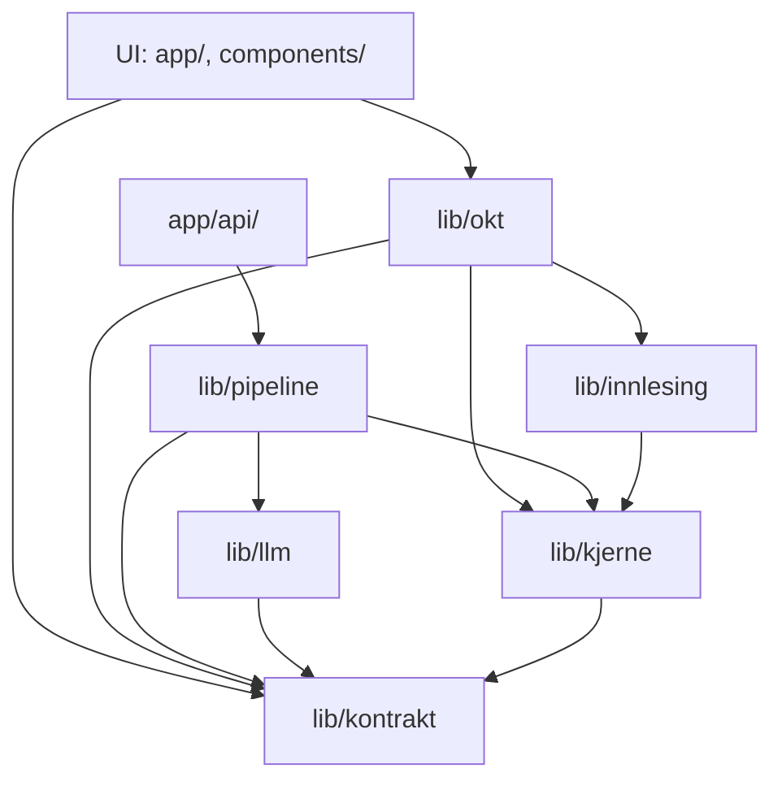
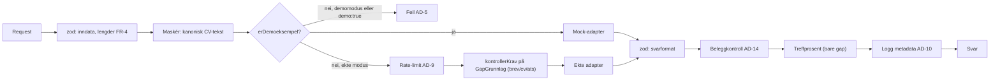
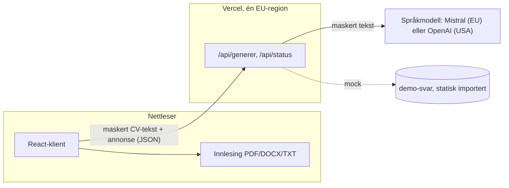
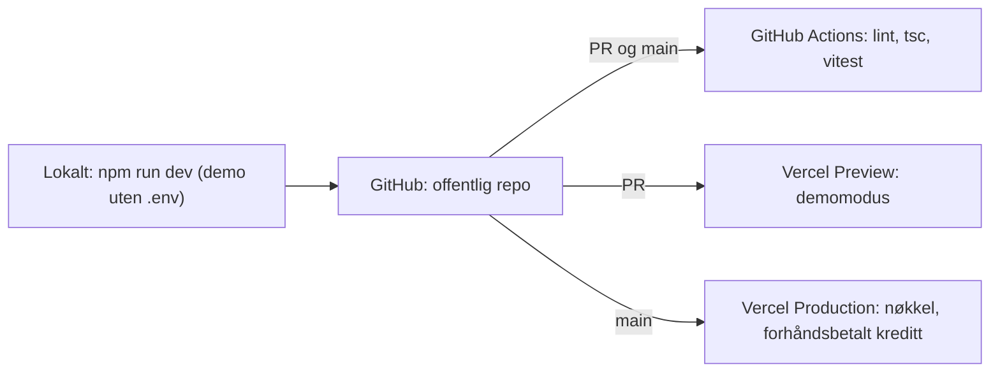

# Arkitekturspine: AI CV & Job Application Assistant

Gruppen (Sondre og Kevin) delegerte alle arkitekturvalg til Claude 2026-11-03. Valgene er tatt etter kriteriene i PRD-en, og begrunnelsene står i `.memlog.md`. Ordene fra PRD §3 brukes uten synonymer.

## Designparadigme

**Funksjonell kjerne / imperativt skall** med **porter og adaptere** for språkmodellen. Next.js brukes som en React-app med en tynn backend.

| Lag | Mappe | Innhold | Kjører i |
| --- | --- | --- | --- |
| Kontrakt | `src/lib/kontrakt/` | zod-skjemaer, delte former (AD-14), feilkoder, `DEMO_CV`, `DEMO_ANNONSE`, konstanter | begge |
| Kjerne (ren) | `src/lib/kjerne/` | `masker` (FR-6), `normaliser`, `kontrollerKrav` (FR-9), `treffprosent` (FR-12), grenser (FR-4), `erDemoeksempel` | begge |
| Innlesing | `src/lib/innlesing/` | PDF, DOCX og TXT til CV-tekst (FR-2) | nettleser (og Node i test) |
| Port + adaptere | `src/lib/llm/` | `LlmKlient`, adapter for Mistral og OpenAI, mock-adapter, `prompter/`, `demo-svar/` | bare server |
| Pipeline | `src/lib/pipeline/` | `generer()` (AD-4), rate-limit, logging | bare server |
| Skall: API | `src/app/api/` | tynne rutehåndterere | server |
| Skall: UI | `src/app/`, `src/components/`, `src/lib/okt/` | klientkomponenter, økt-tilstanden, fetch-innpakningen | nettleser |



## Invarianter og regler

### AD-1: Next.js som React-app med tynn backend [ADOPTED]

- **Binds:** all
- **Prevents:** at noen lager en egen backend eller Python-tjeneste, bruker Server Actions eller lar tilstand ligge både på server og klient.
- **Rule:** Alt brukergrensesnitt er klientkomponenter (`'use client'`). Serveren har bare API-rutene i AD-5. Ingen Server Actions, ingen database og ingen innlogging. Cache Components er slått av.

### AD-2: Avhengighetsretningen er låst og håndheves

- **Binds:** all
- **Prevents:** at deterministiske regler kopieres inn i UI eller prompter, og at nøkkelen eller promptene havner i nettleseren.
- **Rule:**
  - Importer bare langs pilene i diagrammet over. `lib/kjerne` og `lib/kontrakt` importerer ingenting annet fra appen.
  - `lib/llm` og `lib/pipeline` starter med `import 'server-only'`.
  - FR-6, FR-9 og FR-12 finnes bare i `lib/kjerne`.
  - UI-komponenter kaller ikke `lib/kjerne` direkte, bare via `lib/okt`.
  - ESLint-regelen `no-restricted-imports` håndhever grensene.

### AD-3: Leverandøren ligger bak én port

- **Binds:** FR-7–FR-17, FR-24, NFR-6, NFR-9, PRD §6
- **Prevents:** at kode utenfor `lib/llm` blir avhengig av én bestemt leverandør, og at demomodus og testene får en egen kodevei.
- **Rule:**
  - **Grensesnitt:** `LlmKlient` har én metode per resultatdel (`analyseGap`, `skrivSoknadsbrev`, `foreslaCvForbedringer`, `foreslaAts`). Metoden tar inn den kanoniske CV-teksten, annonsen og eventuelt `GapGrunnlag`, og returnerer et rått svar som ikke er kontrollert, sammen med antall tokens.
  - **Kall:** Adaptere bruker `generateText` med `Output.object(zodSkjema)` og `instructions` fra Vercel AI SDK. Innstillingene er `maxRetries: 0`, `abortSignal: AbortSignal.timeout(LLM_TIDSGRENSE_MS)` med 45 000 ms og temperatur 0–0,3. Mistral bruker i tillegg `strictJsonSchema: true`.
  - **Valg av adapter:** `LLM_LEVERANDOR` (`mistral` eller `openai`, standard `mistral`) velger adapter, og `LLM_MODELL` velger modell.
  - **Mock-adapter:** importerer demosvarene statisk fra `lib/llm/demo-svar/` (én JSON per resultatdel, i det rå svarformatet).
  - **Prompter:** Alle ligger i `lib/llm/prompter/`. CV-teksten, annonsen og `GapGrunnlag` er avgrenset som data i promptene, sammen med en instruks om å ignorere instrukser inne i dem.

### AD-4: Én genereringspipeline for alle resultatdeler og begge modi

- **Binds:** FR-6, FR-9, FR-12, FR-15–FR-17, FR-22, FR-24, FR-26, NFR-3, NFR-9
- **Prevents:** at demo og ekte modus, eller to resultatdeler, kontrolleres ulikt.
- **Rule:**
  - `generer()` kjører stegene i diagrammet under i fast rekkefølge.
  - Alt etter steg C bruker den kanoniske CV-teksten (AD-13).
  - Belegg kontrolleres med `kontrollerKrav` og belegglogikken i AD-14.
  - Treffprosenten regnes ut bare i pipelinen. UI-et og språkmodellen regner den aldri ut.



### AD-5: API-flaten

- **Binds:** FR-5, FR-7–FR-19, FR-23–FR-26, NFR-4, NFR-9
- **Prevents:** at hver resultatdel får sin egen rute, sitt eget request-format eller sin egen regel for demo, og at serveren stoler på data som er hentet fra klienten.
- **Rule:** Det finnes to ruter.

  **`GET /api/status`** er dynamisk (`force-dynamic`) og svarer `{ modus: 'ekte' | 'demo', leverandor: { navn, land, tredjeland } }`. Modusen er `demo` når nøkkelen for `LLM_LEVERANDOR` mangler.

  **`POST /api/generer/[resultatdel]`**, der `resultatdel` er `gap`, `brev`, `cv` eller `ats`.
  - **Body:** `{ cvTekst, annonse, demo?: boolean, gap?: GapGrunnlag }`. `gap` er påkrevd for `brev`, `cv` og `ats`.
  - **`GapGrunnlag`:** `{ krav: { tekst, kategori, belegg[] }[], nokkelord: { tekst, kravIndeks }[] }`, uten fritekst og med grenser for antall og lengde. Det bygges fra den uredigerte gap-analysen (FR-18).
  - **Demo:** Mock-adapteren brukes bare når `erDemoeksempel(cvTekst, annonse)` er sann. Ellers er svaret `demo_krever_nokkel` i demomodus og `ugyldig_inndata` når `demo: true` sendes i ekte modus.
  - **Svar:** Svarene strømmes ikke, og hvert svar valideres helt. `maxDuration` er 60 s.

### AD-6: Økt-tilstanden har én eier, og bare den starter genereringer

- **Binds:** FR-3, FR-5, FR-18–FR-21, FR-26, NFR-1, NFR-3
- **Prevents:** at to komponenter eier de samme dataene, at genereringer bygger på redigert eller ny utkasttekst, at sene svar overskriver en nyere kjøring, og at genereringer startes to ganger.
- **Rule:** All tilstand ligger i én React-context med `useReducer` i `lib/okt`, og endres bare gjennom navngitte handlinger (actions).

  **`okt`** varer hele økten:
  - `bekreftetPersonvern`
  - `modus`
  - `leverandor` (fra `/api/status`)

  **`innhold`** tømmes av *Ny analyse*:
  - `utkast: { cvTekst, annonse }`, det brukeren redigerer i forberedelsen
  - `kjoring: { id, cvTekst, annonse, erEksempel }`, satt av *Analyser* fra `utkast`. `cvTekst` er maskert.
  - `resultatdeler`: per `resultatdel` `{ status: 'venter' | 'genererer' | 'feil' | 'ferdig', feilkode, generert, redigert, gapVersjon }`. `redigert` er `null` eller har samme form som `generert`. En resultatdel er redigert når `redigert !== null`, og visning og kopiering bruker `redigert ?? generert`.
  - `gapVersjon`, som øker for hver gap-generering

  **Genereringer:**
  - Bare `startGenerering(resultatdel)` i `lib/okt` sender requester. Den har en vakt mot dobbeltstart og en egen `AbortController`. Fanekomponenter starter aldri en fetch selv.
  - Requester bygges bare fra `kjoring` og fra `generert` for gap. Brev, CV og ATS starter når fanen åpnes og gap er `ferdig`.
  - Svar fra en `kjoring.id` eller `gapVersjon` som ikke lenger gjelder, forkastes.
  - *Analyser* nullstiller alle resultatdeler. En resultatdel med lavere `gapVersjon` enn gjeldende vises som «basert på forrige analyse».
  - Er `modus === 'demo'` og `erEksempel` usann, blir brukeren i forberedelsen med varselet fra FR-26.

  **Lagring:** Ingenting skrives til localStorage, sessionStorage, IndexedDB eller cookies.

### AD-7: Innlesing skjer bare i nettleseren

- **Binds:** FR-1–FR-3, NFR-4, NFR-6
- **Prevents:** at filer sendes til serveren, og at uttrekket ikke kan testes.
- **Rule:**
  - `lib/innlesing` har rene funksjoner fra `ArrayBuffer` til `string`. PDF leses med pdfjs-dist og kolonneregelen i addendum B, DOCX med mammoth og TXT som UTF-8.
  - PDF-funksjonen får `getDocument` injisert. I nettleseren settes `workerSrc` i en klientmodul (`new URL('pdfjs-dist/build/pdf.worker.min.mjs', import.meta.url)`). Tester i Node bruker `pdfjs-dist/legacy/build/pdf.mjs`.
  - Serveren tar bare imot CV-tekst som JSON.

### AD-8: Fast feilformat fra rute til skjerm

- **Binds:** FR-22, NFR-3, NFR-9
- **Prevents:** at hver rute finner opp sitt eget feilformat, og at plattformfeil som 504 havner utenfor formatet.
- **Rule:**
  - **Format:** API-feil er HTTP-status pluss `{ feil: { kode } }`.
  - **Koder:** `kode` er én av `ugyldig_inndata` (400), `for_lang_tekst` (413), `for_kort_tekst` (400), `grense_naadd` (429), `llm_feil` (502), `llm_tidsavbrudd` (504), `ugyldig_svar` (502) og `demo_krever_nokkel` (403). Enumen og statustabellen ligger i `lib/kontrakt`.
  - **Fetch-innpakning:** Én innpakning i `lib/okt` gjør om 504, nettverksfeil og svar som ikke er JSON, til `llm_tidsavbrudd` eller `llm_feil`.
  - **Meldinger:** De norske meldingene står i én tabell i UI-et. *Prøv igjen* vises for `llm_feil`, `llm_tidsavbrudd` og `ugyldig_svar`. Fil- og formatfeil oppstår bare i nettleseren og bruker samme tabell.

### AD-9: Rate-limit uten kjennetegn på brukeren

- **Binds:** NFR-1, NFR-3
- **Prevents:** at noen bruker IP-adresser, hash, cookies eller en ekstern lagringstjeneste til grenser, og at genereringer blir telt på ulike måter.
- **Rule:**
  - **Teller:** én teller i minnet per serverinstans, som nullstilles ved kald start. Den tillater høyst `GRENSE_PER_MINUTT` (standard 10) og `GRENSE_PER_DOGN` (standard 200, UTC-døgn) genereringer.
  - **Telling:** Hver ekte generering telles i steg D uansett utfall, også nye genereringer. Demo telles ikke.
  - **Svar:** Når grensen er nådd, er svaret `grense_naadd`.
  - **Hard grense:** forhåndsbetalt kreditt hos leverandøren uten automatisk påfylling, satt under semesterbudsjettet på 200 kr.

### AD-10: Bare metadata logges

- **Binds:** NFR-1, SM-8
- **Prevents:** at innhold lekker til logger eller til sporing hos tredjepart.
- **Rule:** Hver generering gir én JSON-logglinje med `{ resultatdel, modus, status, varighetMs, inputTokens, outputTokens, feilkode }`. Body i requester, CV-tekst, annonse, prompter, svar og rå feilobjekter logges aldri. Ingen analyse- eller sporingsverktøy i v1.

### AD-11: Valg av leverandør avgjøres ved måling

- **Binds:** PRD §6, §10.1, FR-5, SM-1–SM-3, SM-8
- **Prevents:** at leverandøren velges på synsing, og at informasjonsteksten sier noe annet enn den faktiske leverandøren.
- **Rule:**
  - **Måling:** I den første story-en for gap-analysen kjøres testsettet med `npm run testsett` (`scripts/kjor-testsett.ts`, krever nøkkel) mot både Mistral og OpenAI. Begge brukes på betalt API, der dataene ikke brukes til trening og det finnes en databehandleravtale (kriterium 1, som sjekkes i vilkårene).
  - **Valgregel:** Mistral velges hvis den består SM-1, SM-2, SM-3 og NFR-5 innenfor 1 kr per kjøring. Ellers velges OpenAI.
  - **Etterpå:** Resultatet noteres i sesjonsloggen. FR-5-teksten bygges bare fra `leverandor` i `/api/status`.

### AD-12: Miljøer, hemmeligheter og CI

- **Binds:** NFR-2, NFR-6, NFR-7, FR-23
- **Prevents:** at nøkkelen havner i nettleseren eller i forhåndsvisninger, at lokalt miljø og produksjon blir ulike, og at tester krever nøkkel.
- **Rule:**
  - **Miljøvariabler:** `MISTRAL_API_KEY`, `OPENAI_API_KEY`, `LLM_LEVERANDOR`, `LLM_MODELL`, `GRENSE_PER_MINUTT` og `GRENSE_PER_DOGN`. Ingen har prefikset `NEXT_PUBLIC_`. En variabel som mangler, gir demomodus eller standardverdien, aldri krasj.
  - **Vercel:** Nøkkelen settes bare i Production, så forhåndsvisninger kjører i demomodus. `vercel.json` setter én EU-region for funksjonene.
  - **Repo:** `.env.example` følger med i repoet. `.gitignore` blokkerer `*.pdf` og `*.docx` utenfor `testdata/`, og `.gitattributes` setter `testdata/** text eol=lf`.
  - **Lokalt:** Node 24, med `engines.node: "24.x"` i `package.json`.
  - **CI:** GitHub Actions kjører på PR og `main`: `npm ci`, lint, `tsc --noEmit` og `vitest run`, uten nøkkel.
  - **Vitest:** `server-only` er aliasert til `server-only/empty.js` i Vitest.

### AD-13: Den kanoniske CV-teksten er maskert

- **Binds:** FR-6, FR-9, FR-12, FR-15–FR-17, FR-26
- **Prevents:** at belegg som siterer `[fødselsnummer fjernet]` feiler mot teksten som ikke er maskert, og at klient og server sammenligner ulike tekster.
- **Rule:**
  - Den kanoniske CV-teksten er `masker(cvTekst)`.
  - Klienten maskerer når kontrollsteget vises og bekreftes, og `kjoring.cvTekst` er alltid maskert.
  - Serveren maskerer på nytt i steg C, i begge modi. Adapter, beleggkontroll, treffprosent og `erDemoeksempel` bruker den teksten.
  - `masker` er idempotent, og en enhetstest bekrefter det.

### AD-14: Delte former og belegglogikk er definert på forhånd

- **Binds:** FR-8–FR-12, FR-15–FR-17, FR-18
- **Prevents:** at gap-story-en og brev-, CV- og ATS-story-ene får ulike former for krav, nøkkelord og nedgradering.
- **Rule:**
  - **Former:** `lib/kontrakt` definerer disse før første generering bygges:
    - `Kategori = 'oppfylt' | 'delvis' | 'mangler'`
    - `Belegg = string`
    - `Krav { tekst, kategori, belegg: Belegg[], forklaring?, raad?, nedgradert: boolean }`
    - `Nokkelord { tekst, kravIndeks: number | null, funnet: boolean }`
    - tellerne `fjernetBelegg` og `fjernetForslag`
  - **`kontrollerKrav`** i `lib/kjerne` fjerner belegg uten treff. Et krav som ikke er `mangler` og står uten gyldig belegg (også tom liste), blir `mangler` med `nedgradert: true`.
  - **Brev, CV og ATS:** I brevets «Bygger på» fjernes belegg uten treff og telles i `fjernetBelegg`. CV- og ATS-forslag uten gyldig belegg fjernes og telles i `fjernetForslag`.
  - Fjernede belegg returneres aldri. Hver resultatdel har sitt eget skjema, satt sammen av disse formene.

### AD-15: Oppstart fra en fast starter

- **Binds:** første story i grunnmuren
- **Prevents:** at standardvalgene i starteren gir en annen app enn spinen beskriver (ingen `src/`, Cache Components, AGENTS.md, Base UI).
- **Rule:**
  - **Starter:** create-next-app kjøres i en midlertidig mappe og flyttes inn i rotmappa: `npx create-next-app@16.4.4 app-tmp --ts --app --src-dir --tailwind --eslint --import-alias "@/*" --use-npm --disable-git --no-react-compiler --no-cache-components --no-agents-md`.
  - **shadcn:** Deretter kjøres `npx shadcn@4.23.0 init -t next -b radix`.
  - **Versjoner:** TypeScript låses til 5.9.x og `@types/node` til `^24`.

## Konvensjoner

| Område | Konvensjon |
| --- | --- |
| Navn på domeneord | Ordene i PRD §3, på norsk uten æøå: `okt`, `kjoring`, `krav`, `kategori`, `belegg`, `nokkelord`, `treffprosent`, `resultatdel`, `generering`. Ingen synonymer. |
| Resultatdel | `'gap' \| 'brev' \| 'cv' \| 'ats'`, de samme verdiene i rute, tilstand og logg. |
| Filer og rammeverk | Konvensjonene i Next.js på engelsk (`page.tsx`, `route.ts`). Komponentnavn i PascalCase på norsk (`Kontrollsteg`, `GapAnalyseFane`). |
| Typer | Avledes fra zod-skjemaene i `lib/kontrakt` (`z.infer`). Ingen typer skrevet for hånd for data som krysser nettverket. |
| Tekst fra språkmodellen | Vises som ren tekst. Aldri `dangerouslySetInnerHTML`. |
| UI-komponenter | shadcn/ui (Radix) med overstyringene i DESIGN.md, ikoner fra lucide-react. shadcn-komponentene i `src/components/ui/`. |
| Tester | Vitest, i `*.test.ts` ved siden av koden. Testnavnene viser til FR-ID (`FR-12: ...`). |

## Stack

| Navn | Versjon |
| --- | --- |
| Node.js (LTS) | 24.x |
| Next.js (App Router) | 16.4.4 |
| React | 19.3.1 |
| TypeScript | 5.9.3 |
| Tailwind CSS | 4.3.4 |
| shadcn (CLI, Radix) | 4.23.0 |
| Vercel AI SDK (`ai`) | 7.0.162 |
| `@ai-sdk/mistral` | 4.0.79 |
| `@ai-sdk/openai` | 4.0.108 |
| zod | 4.6.7 |
| pdfjs-dist | 6.5.438 |
| mammoth | 1.13.0 |
| Vitest | 5.1.0 |
| Vercel (Hobby, Fluid compute) | n/a |

## Strukturelt seed





```text
src/
  app/
    page.tsx
    api/status/route.ts
    api/generer/[resultatdel]/route.ts
  components/            # appens komponenter; ui/ = shadcn
  lib/
    kontrakt/            # skjemaer, former, feilkoder, DEMO_CV, DEMO_ANNONSE
    kjerne/              # masker, normaliser, kontrollerKrav, treffprosent, grenser, erDemoeksempel
    innlesing/           # pdf, docx, txt
    llm/                 # LlmKlient, adaptere, mock, prompter/, demo-svar/
    pipeline/            # generer, rate-limit, logg
    okt/                 # context, reducer, startGenerering, fetch-innpakning
scripts/kjor-testsett.ts # npm run testsett (krever nøkkel)
testdata/                # testpar, fasit (finnes allerede)
.github/workflows/ci.yml
vercel.json
.env.example
```

## Kart fra krav til arkitektur

| Krav | Ligger i | Styres av |
| --- | --- | --- |
| FR-1–FR-3 innlesing og kontrollsteg | `lib/innlesing`, `lib/okt`, UI | AD-6, AD-7 |
| FR-4 lengdegrenser | `lib/kjerne` (klient og server) | AD-4, AD-5 |
| FR-5 personvern | UI, `/api/status` | AD-5, AD-6, AD-11 |
| FR-6 maskering | `lib/kjerne` | AD-13 |
| FR-7–FR-11 gap-analyse | `lib/llm`, `lib/pipeline` | AD-3, AD-4, AD-14 |
| FR-12–FR-13 treffprosent | `lib/kjerne`, kalt fra pipelinen | AD-2, AD-4 |
| FR-14–FR-17 brev, CV- og ATS-forslag | `lib/llm`, `lib/pipeline` | AD-3, AD-4, AD-5, AD-14 |
| FR-18–FR-21 redigering, ny generering, kopiering, ny analyse | `lib/okt`, UI | AD-6 |
| FR-22 feil | `lib/kontrakt`, `lib/okt`, UI-tabellen | AD-8 |
| FR-23–FR-26 demomodus | mock-adapter, `/api/status`, `erDemoeksempel` | AD-3, AD-5, AD-6 |
| FR-27 ingen oppdiktning | prompter, beleggkontroll | AD-3, AD-4, AD-14 |
| NFR-1 personvern | hele appen | AD-6, AD-9, AD-10 |
| NFR-2 hemmeligheter | miljø, `.gitignore` | AD-12 |
| NFR-3 kostnad | `lib/pipeline`, leverandørkonto | AD-6, AD-9, AD-11 |
| NFR-4 ytelse | lastetilstand i UI, tidsgrense | AD-3, AD-5 |
| NFR-5 språk | prompter, testsett | AD-3, AD-11 |
| NFR-6 testbarhet | mock-adapter, Vitest, CI | AD-3, AD-7, AD-12 |
| NFR-7 kjørbarhet | README, demo uten `.env` | AD-12 |
| NFR-8 tilgjengelighet | UI (shadcn/Radix, DESIGN.md) | konvensjonen for UI-komponenter |
| NFR-9 upålitelig inndata | prompter, ruter, visning | AD-3, AD-5, konvensjonen for tekst fra språkmodellen |
| NFR-10 sporbarhet | stories, tester, commits, `.logs/` | konvensjonen for tester, AD-11 |

## Utsatt

- **Konkret modell (`LLM_MODELL`)** for hver leverandør: avgjøres i målingen i AD-11.
- **EU-region (`fra1` eller `arn1`, begge finnes)**: velges når Vercel-prosjektet opprettes i første story med en kjørbar app.
- **Om Vercels plattformlogger viser IP-adresser**: sjekkes i dashboardet etter første publisering. Hvis de gjør det, nevnes det i FR-5-teksten.
- **Feltene i skjemaet for hver resultatdel** utover formene i AD-14: eies av story-en som bygger resultatdelen.
- **Strømming av svar**: ikke i v1. Vurderes bare hvis NFR-4 ikke nås.
- **E2E-tester i nettleser (Playwright)**: ikke i v1.
- **TypeScript 7**: når typescript-eslint støtter det.
