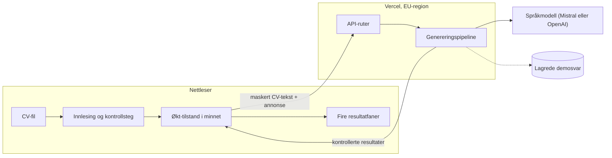
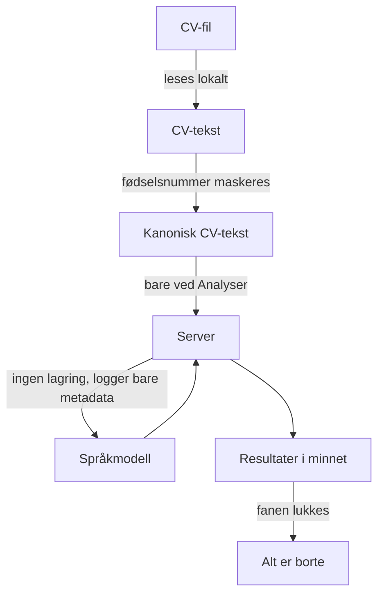
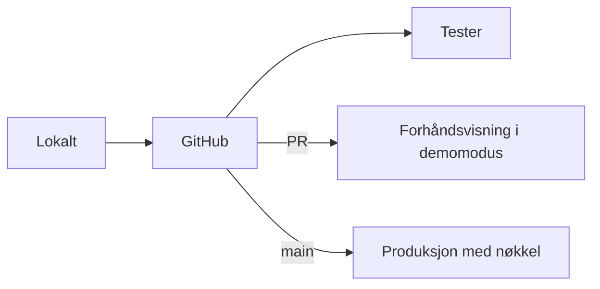

# Arkitekturoversikt

Dette dokumentet forklarer arkitekturen og begrunner valgene. Det er skrevet for sensor og for refleksjonsrapporten. Selve beslutningene står i [ARCHITECTURE-SPINE.md](ARCHITECTURE-SPINE.md) med faste ID-er (AD-1 til AD-15), som stories og kode viser til. Alle valg og forkastede alternativer er logget i `.memlog.md`.

## Hvem tok valgene

Gruppen hadde ingen erfaring med React eller Next.js. Vi ba derfor Claude (KI) ta arkitekturvalgene ut fra kravene i PRD-en, og logget delegeringen. Fem uavhengige KI-gjennomganger gikk gjennom utkastet: avstemming mot PRD, avstemming mot UX, sjekkliste, sjekk av at teknologien er oppdatert, og en gjennomgang som angrep spinen. Gjennomgangene fant blant annet at TypeScript 7 ikke virker med ESLint-oppsettet i Next.js, og at serveren stolte på data fra nettleseren. Begge feilene er rettet. Rapportene ligger i `reviews/`.

## Hele systemet på én side

1. **CV-filen forlater aldri nettleseren.** PDF og DOCX leses ut til tekst lokalt. Det oppfyller FR-2 og holder datamengden nede.
2. **Fødselsnummer maskeres** før teksten sendes, først i nettleseren og så en gang til på serveren.
3. **Serveren er tynn.** Den har to ruter og ingen database, og lagrer ingenting (NFR-1).
4. **Alt som må være riktig, sjekkes i kode og ikke av språkmodellen.** Det gjelder belegg, nedgradering til **Mangler**, treffprosent og lengdegrenser.

## De viktigste valgene og hvorfor

| Valg | Alternativer vi vurderte | Hvorfor |
| --- | --- | --- |
| **Next.js 16 med TypeScript, brukt som React-app med tynn backend** (AD-1) | Vite/React + Python FastAPI, Vite/React + Express | Ett språk og ett prosjekt passer to nybegynnere. Python-alternativet ville sendt CV-filen til serveren, og det bryter FR-2. UX-en er allerede tegnet med shadcn på Next.js. |
| **Funksjonell kjerne og imperativt skall** (paradigme, AD-2) | Logikk spredt i komponenter | Reglene som må være deterministiske (FR-6, FR-9, FR-12), er rene funksjoner som er lette å enhetsteste, og de finnes bare ett sted. |
| **Språkmodellen bak ett grensesnitt** (AD-3) | Kalle én leverandør direkte | Vi kan bytte leverandør på én linje, og demomodus og testene bruker en mock av det samme grensesnittet (NFR-6). |
| **Leverandør velges ved måling: Mistral hvis kvaliteten holder, ellers OpenAI** (AD-11) | Claude, Gemini | Mistral holder dataene i EU, så det blir ingen overføring til USA. Norsk kvalitet er rangert høyere i PRD §6, så Mistral må bestå testsettet først. Gemini ble valgt bort fordi gratisnivået kan trene på data. Claude ble holdt utenfor fordi valget ble tatt av en Claude-modell. |
| **Én pipeline for alle resultatdeler og begge modi** (AD-4) | Egen kode per fane og en egen demovei | Demomodus kontrolleres nøyaktig som ekte modus. Det følger av FR-24. |
| **Serveren stoler ikke på nettleseren** (AD-5, AD-13) | Bruke gap-analysen som klienten sender | En endret klient kunne gjort **Mangler** om til **Oppfylt** og fått brevet til å påstå kvalifikasjoner. Serveren kontrollerer beleggene på nytt. |
| **Rate-limit uten IP-adresser** (AD-9) | Grense per IP med Upstash eller Vercel KV | IP-adresser er personopplysninger (gruppens avklaring 30.10). Det sikre taket er forhåndsbetalt kreditt hos leverandøren. |
| **All tilstand i én eier i nettleseren** (AD-6) | Tilstand spredt i komponentene | Sene svar kan ikke overskrive en ny analyse, en generering starter ikke to ganger, og ingenting lagres i nettleseren. |

## Personvern i arkitekturen

## Kvalitet og testing

- **Enhetstester** (Vitest): maskering, beleggkontroll, treffprosent og tekstuttrekk fra testpar 1 (DOCX) og testpar 4 (PDF med to kolonner).
- **Flyttest** for demoeksempelet med mock-klienten.
- **GitHub Actions** kjører lint, typesjekk og tester på hver endring, uten API-nøkkel.
- **`npm run testsett`** kjører de fire testparene mot den ekte språkmodellen. Det er grunnlaget for SM-1 til SM-3 og for valget av leverandør.

## Publisering

API-nøkkelen finnes bare i produksjonsmiljøet på Vercel. En forhåndsvisning kan derfor ikke bruke opp budsjettet. Sensor kan kjøre appen i demomodus uten nøkkel (NFR-7).

## Dette er ikke bestemt ennå

- Hvilken modell hos leverandøren: avgjøres ved målingen.
- EU-regionen på Vercel (Frankfurt eller Stockholm): velges når prosjektet opprettes.
- Om Vercel logger IP-adresser i sine egne logger: sjekkes etter første publisering, og nevnes i så fall i personvernteksten.
